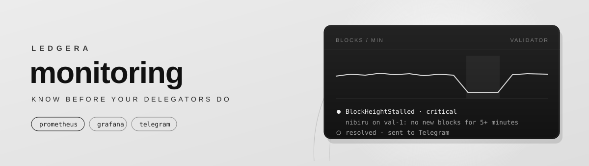

<p align="center">
  
</p>

<p align="center">
  The Prometheus alerts and Grafana dashboard <a href="https://proledgera.com">Ledgera</a> uses to watch its validators.<br/>
  Built for nodes installed with <a href="https://github.com/LedgeraLedgera/node-scripts">node-scripts</a>, and works with any CometBFT chain.
</p>

---

```text
 node servers                        monitoring host
 ─────────────────────────           ─────────────────────────────────────────────
 celestia-appd   :26660  ──┐
 nibid           :27660  ──┼──────►  Prometheus ──► Alertmanager ──► Telegram
 node_exporter   :9100   ──┘              │
                                          └──────► Grafana · Ledgera / Nodes
```

Every node installed with `node-scripts` already exposes CometBFT metrics on `<port prefix>660`. This repository adds three things: host metrics through node_exporter, the alert rules, and one dashboard for every network and server.

## Quick start

**1. On the monitoring host** (Docker with the compose plugin):

```bash
git clone https://github.com/LedgeraLedgera/monitoring && cd monitoring
bash setup.sh
```

`setup.sh` generates the Grafana admin password and asks for a Telegram bot token and chat id. It sends a test message to confirm they work, then starts Prometheus v3.15.1, Alertmanager v0.34.1 and Grafana 13.2.5.

**2. On every node server:**

```bash
git clone https://github.com/LedgeraLedgera/monitoring && cd monitoring
bash scripts/node-exporter.sh --allow <monitoring-host-ip>
```

It installs node_exporter v1.12.1 (sha256-checked) under systemd and opens the metrics ports to the monitoring host only, if `ufw` is active. Then it prints the target lines for every node `node-scripts` installed on that server:

```yaml
# prometheus/targets/cometbft.yml
- targets: ["10.0.0.11:26660"]
  labels:
    network: celestia-mocha
    host: val-1
```

**3. Paste those lines** into `prometheus/targets/*.yml` on the monitoring host. Prometheus picks them up within a minute, with no restart. Check `http://127.0.0.1:9090/targets`: every target should be `UP`.

## Alerts

| alert | severity | fires when |
|---|---|---|
| `ValidatorNotSigning` | critical | the last signed block is more than 20 heights behind for 2 min (jailed, key not loaded, node stuck) |
| `ValidatorMissingBlocks` | warning | more than 30 blocks missed in 15 minutes |
| `BlockHeightStalled` | critical | no new blocks for 5+ minutes while the node is not syncing (stuck node or chain halt) |
| `NodeCatchingUp` | warning | block sync or state sync has been running for 15+ minutes |
| `NodeDown` | critical | the metrics endpoint stopped answering |
| `NodeServiceNotActive` | critical | systemd reports `celestia-appd`, `celestia-fibre`, `nibid`, `dymd` or `lavad` as not running |
| `NoPeers` / `LowPeers` | critical / warning | 0 peers for 2 min / fewer than 5 for 10 min |
| `ConsensusRoundsHigh` | warning | blocks need more than 2 rounds for 5 min, usually a network-wide issue |
| `DiskSpaceLow` / `DiskSpaceCritical` | warning / critical | less than 15% / 5% free on a disk |
| `DiskWillFillIn24h` | warning | disk usage is growing fast enough to fill the disk within 24 hours |
| `MemoryHigh` / `CPUHigh` | warning | memory above 92% for 10 min / CPU above 90% for 15 min |
| `ClockDrift` | warning | clock is off by more than 0.5 s |
| `HostDown` | critical | node_exporter is unreachable |

Alertmanager suppresses the noise that follows from one cause. A dead server mutes everything else on it, a dead node mutes its signing, height and peer alerts, and a node that is catching up does not also page you for not signing. Critical alerts repeat every hour, warnings every 4 hours, and every alert sends a message when it resolves.

The rules are in [`prometheus/rules/`](prometheus/rules). Thresholds are plain numbers in the expressions, so tune them to your networks' block times.

## Dashboard

**Ledgera / Nodes** loads automatically. Filter it by network and host.

- **Consensus**: height, blocks per minute, peers, signing lag, missed blocks, sync state, block interval p50/p95, rounds per height, mempool size
- **Host**: disk free, CPU, memory, network traffic, disk I/O time

The validator panels (signing lag and missed blocks) only show data on nodes that hold a key in the active set.

## Access

Prometheus, Alertmanager and Grafana listen on `127.0.0.1` only. Reach them through an SSH tunnel:

```bash
ssh -L 3000:127.0.0.1:3000 -L 9090:127.0.0.1:9090 <monitoring-host>
```

To publish Grafana, set `GRAFANA_BIND=0.0.0.0` in `.env` and put it behind HTTPS.

On the node servers, CometBFT's metrics port binds to all interfaces by default. Keep `9100` and the `<prefix>660` ports closed to everyone except the monitoring host; `--allow` does this when `ufw` is active.

## Layout

```text
setup.sh                         monitoring host: secrets, targets, start, reload
docker-compose.yml               Prometheus · Alertmanager · Grafana (pinned versions)
prometheus/prometheus.yml        scrape jobs (cometbft, node)
prometheus/rules/                cometbft.yml · host.yml
prometheus/targets/              *.example.yml — your cometbft.yml / node.yml are git-ignored
alertmanager/alertmanager.yml    Telegram receiver, grouping, inhibition
grafana/                         provisioning + dashboards/ledgera-nodes.json
scripts/node-exporter.sh         node servers: node_exporter + target lines
```

After editing rules or `alertmanager.yml`, apply the changes with `bash setup.sh reload`.

---

<p align="center">
  <a href="https://proledgera.com">proledgera.com</a> ·
  <a href="https://github.com/LedgeraLedgera/node-scripts">node-scripts</a> ·
  <a href="https://github.com/LedgeraLedgera">github</a>
</p>
